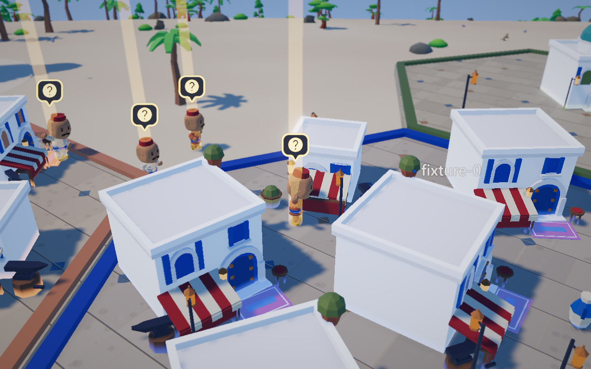
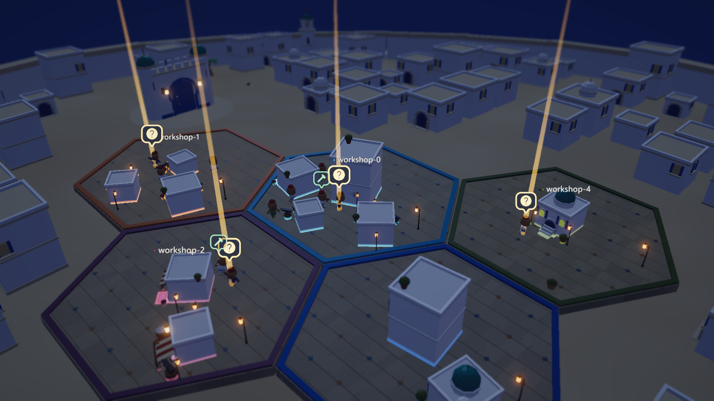

# Souk

Your coding-agent threads, as artisans in a Tunisian medina.

Every agent thread running on your machine (Claude Code, Codex, Cursor, OpenCode and more) becomes an artisan in a red chechia. Every repo becomes a whitewashed workshop with a blue door and a striped awning. Artisans hammer copper while their thread works, stop under a lantern beam when the thread needs your reply, and fall asleep when it has been idle for days. Click an artisan to open its thread.



> **Souk is a fork of [Bot Crossing](https://github.com/Station-Sciences/bot-crossing) by [Jarren Rocks](https://jarren.rocks)**, used under the MIT licence.
> The engine, the harness adapters, the agent rig and animation system, and most of the code in this repository are his work.
> Souk is a reskin: the medina concept, the setting, the artisans and the Tunisian art direction are mine.
> Souk is not affiliated with or endorsed by the Bot Crossing project. See [Credits](#credits-and-licence).

## What Souk changes

- **Concept** - threads as artisans and repos as workshops in a medina souk ([CONCEPT.md](CONCEPT.md))
- **Setting** - a walled medina with a gate (Bab), dense whitewashed houses, domes, palms, limestone paving and Sidi Bou Said blue
- **Artisans** - chechia hat, robes and sash, mustached faces, a copper hammer and anvil
- **Workshops** - whitewashed blocks with arches, blue doors, awnings, pots and rugs that grow with the work done in the repo
- **Night** - copper lanterns, lit windows, an indigo sky, and a tall lantern beam over every artisan who is waiting on you
- **Performance** - a tighter walled map, a cheaper post-processing chain, a pixel-ratio cap and GPU quality tiers

| State of the thread | What the artisan does |
| --- | --- |
| Working | Hammers copper at its workshop, sparks fly |
| Waiting on you | Stops under a lantern beam with a `?` over its head. Click it to open the thread |
| Errored | Blocked, red eyes, a `!` over its head |
| PR merged | Celebrates with confetti |
| Untouched for days | Falls asleep on the job |
| Anything else | Potters about its workshop |



## Run it

```bash
npm install
npm run dev
```

Needs Node 22.13 or newer. `npm test` runs the test suite. Works on macOS, Linux and Windows.

## Privacy

Souk runs only on your machine. It reads each harness's local session files, never writes to them, uploads nothing, and binds to `127.0.0.1`. The only file it writes is `data/colony.json` (the map layout), which is gitignored. Details are in [Keeping it local](UPSTREAM-README.md#keeping-it-local).

## Technical reference

The full documentation from Bot Crossing (supported harnesses, controls, rendering, animation, performance and how to add a harness adapter) is in [UPSTREAM-README.md](UPSTREAM-README.md). It still applies to Souk, with astronauts read as artisans and the ship read as the medina gate.

## Credits and licence

- **Bot Crossing** by Jarren Rocks - the original project this is forked from. Code under the MIT licence, see [LICENSE](LICENSE). The name "Bot Crossing" and the crew character design are reserved by its author, see [TRADEMARKS.md](TRADEMARKS.md). Souk does not use either as its name or identity.
- **3D assets** - CC0 packs by Kay Lousberg and Kenney, see [public/assets/CREDITS.md](public/assets/CREDITS.md).
- **Souk** concept, art direction and medina reskin by [Farouk Battikh](https://github.com/FARUKxKUN). Released under the same MIT licence.

The full commit history is kept, so every change is credited to the person who made it.
